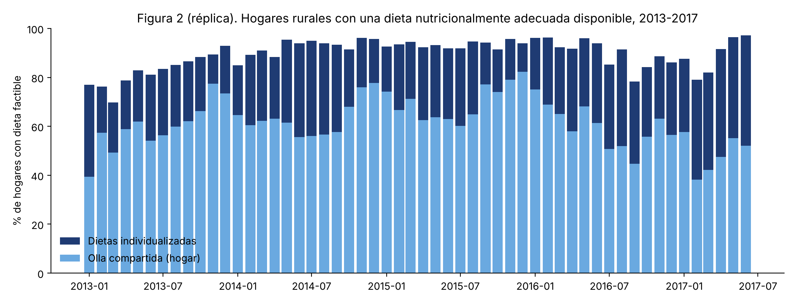
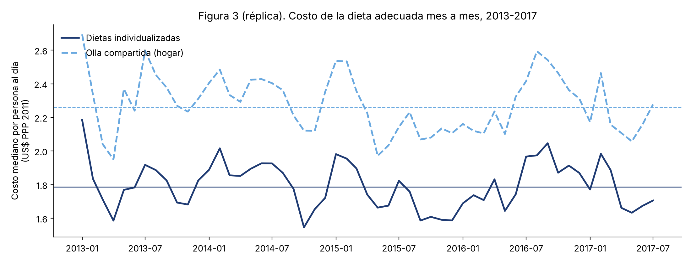
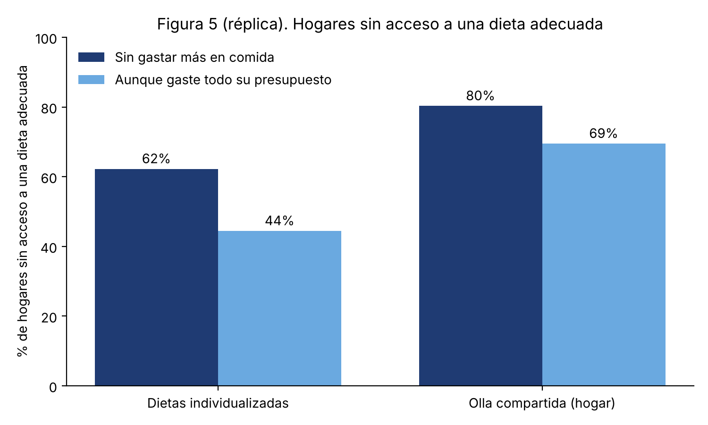

# Réplica de Schneider et al. (2023) en Python

**Artículo replicado:** Schneider, K. R., Christiaensen, L., Webb, P. y Masters, W. A. (2023). *Assessing the affordability of nutrient-adequate diets*. American Journal of Agricultural Economics, 105(2), 503-524. Q1. https://doi.org/10.1111/ajae.12334

**Datos de la autora:** Harvard Dataverse, https://doi.org/10.7910/DVN/AXDJZ8 (encuesta IHPS de Malawi 2013 y 2016/17, más los precios mensuales de 25 mercados rurales).

**Autores de la réplica:** Leandro Zegarra Garcia y Jesus Andre Aybar Reyes, Ingeniería de Sistemas, Universidad de Lima. Proyecto de Investigación 2026-2.

## Qué hace el artículo, en simple

El artículo calcula cuánto cuesta, como mínimo, una dieta que cubra todos los nutrientes que necesita cada familia rural de Malawi, mes a mes, con los alimentos que de verdad se venden en su mercado. Lo resuelve con programación lineal y lo calcula de dos formas:

1. **Dietas individualizadas** (límite inferior): cada persona come su propia dieta ideal.
2. **Olla compartida** (límite superior): toda la familia come de la misma olla, así que la mezcla de alimentos tiene que alcanzar para el miembro más exigente.

Luego compara ese costo con lo que cada hogar gasta en realidad, para saber cuántos hogares pueden pagarla.

## Cómo correrlo

```bash
pip install -r requirements.txt
python 01_resolver_canastas.py     # resuelve 83 431 programas lineales (unos 3 minutos)
python 02_tablas_y_figuras.py      # Tablas 1, 2, 3 y Figuras 2, 3, 5
python 03_comparar_con_paper.py    # tabla final: artículo vs réplica
```

La carpeta `datos/` ya trae los datos de la autora reducidos a lo necesario (unos 7 MB). Si quieres partir de los archivos originales de Dataverse (1,4 GB), descárgalos y corre antes `python 00_preparar_datos.py RUTA_DE_LOS_ARCHIVOS`.

## Archivos

| Archivo | Para qué sirve |
|---|---|
| `00_preparar_datos.py` | Lee los .dta originales y guarda solo las columnas que usamos en `datos/`. |
| `01_resolver_canastas.py` | Vuelve a resolver con nuestro propio código la canasta de menor costo de cada hogar en cada mes (olla compartida). Usa scipy con el solver HiGHS; la autora usó lpSolve en R. |
| `02_tablas_y_figuras.py` | Reproduce las tablas y figuras siguiendo la lógica del código Stata de la autora, con pesos muestrales. |
| `03_comparar_con_paper.py` | Junta los números del artículo y los nuestros en una sola tabla. |
| `resultados/` | Tablas en CSV, figuras en PNG y los registros de cada paso. |

## Resultados

| Indicador | Artículo | Réplica (datos de la autora) | Réplica (nuestras canastas) |
|---|---|---|---|
| Hogares rurales analizados | 3117 | 3117 | 3117 |
| % de meses con dieta factible, individualizado | 90 (89,72) | 89,72 | n.a. |
| % de meses con dieta factible, olla compartida | 60 (60,18) | 60,18 | 60,18 |
| Costo mediano por persona al día, individualizado (US$ PPP 2011) | 1,79 | 1,79 | n.a. |
| Costo mediano por persona al día, olla compartida (US$ PPP 2011) | 2,26 | 2,26 | 2,26 |
| % de hogares sin acceso sin gastar más en comida, individualizado | 62 | 62,2 | n.a. |
| % de hogares sin acceso sin gastar más en comida, olla compartida | 80 | 80,3 | n.a. |
| Prima por compartir la olla (%) | 33 | 32,6 | n.a. |

**Comprobación del optimizador:** de los 83 431 problemas hogar-mes, nuestro código encuentra exactamente los mismos casos factibles que la autora (100 % de coincidencia) y el costo difiere en una mediana de 0,000001 % (correlación 1,00000000). Es decir, el resultado no depende de la herramienta con la que se resuelva.

Solo replicamos con nuestro propio solver el escenario de olla compartida, que es el aporte central del artículo. Para el individualizado (un problema por persona, unas 400 000 personas-mes) usamos los costos que publicó la autora.

## Figuras





## Qué tomamos de este artículo para nuestra tesis

Nuestra tesis calcula el costo de una canasta nutricionalmente adecuada para familias de Lima Metropolitana. De este artículo usamos:

- el modelo de programación lineal con mínimos (EAR), máximos (UL) y rangos de macronutrientes (AMDR);
- la regla de la olla compartida para armar los requerimientos de una familia según su composición;
- la idea de comparar el costo de la canasta con el gasto real del hogar.

Lo que añadimos nosotros es el pronóstico de precios con machine learning, para estimar la canasta antes de que se publiquen los precios.
